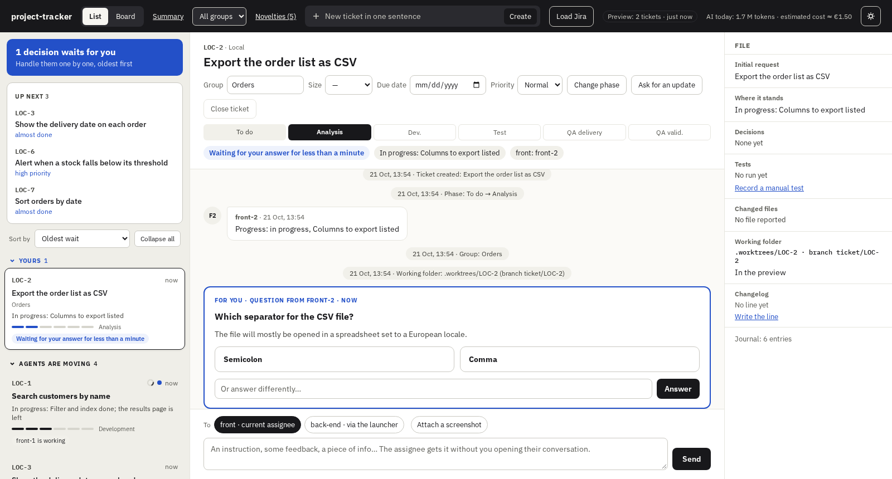
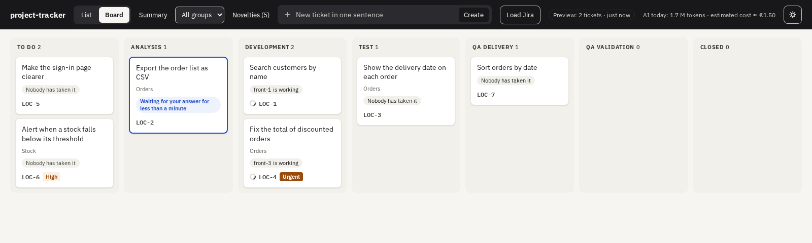
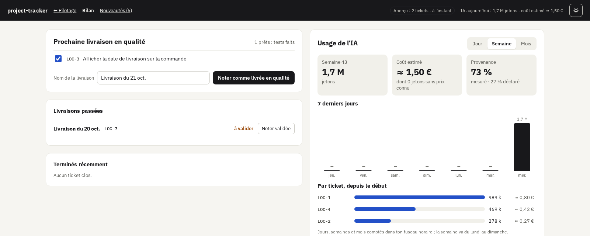

<div align="center">

# project-tracker

**Mission control for a developer running several AI agents on several tickets at once.**

Every ticket keeps its full story: the request, the decisions, the questions, the tests, the AI cost.<br>
Every agent reports to one place, whatever tool it runs on.

[](LICENSE)
[](https://nodejs.org)
[](tsconfig.json)
[](packages/web)
[](#plug-in-any-agent)
[](#contributing)

[Why](#why) · [Features](#features) · [How it works](#how-it-works) · [Quick start](#quick-start) · [Back-end agents](#optional-back-end-agents-on-another-machine) · [Contributing](#contributing)



</div>

## Why

You hand a ticket to an AI agent, then another, then a third. An hour later:

- one agent is **waiting for your answer** in a conversation you closed;
- another made a **decision** you will never find again;
- two of them are **editing the same file**;
- and you have no idea **what it all cost**.

project-tracker puts **the ticket at the centre**. Agents report their progress, decisions and questions to it; you see at a glance what waits for you, answer from one page, and your answer reaches the agent that asked. Nothing lives only in a chat window any more.

## Features

- 🎯 **One page for every ticket**: tickets grouped by who must act (you, an agent, the back-end, a user), with phase, progress and waits.
- 💬 **Questions with options**: agents ask with context, options and a recommendation; you answer in one click, and the answer is routed back.
- 🤖 **Agent-agnostic**: Claude Code, Codex, OpenCode… anything that speaks **MCP** or runs a **CLI**. Claude Code gets hooks that do it automatically.
- 🌳 **One git worktree per ticket**: agents never step on each other; overlapping files are flagged early.
- 🔀 **Integration preview**: one branch that merges every open ticket, one dev server, merge conflicts shown on the tickets they concern.
- ✅ **Clean history**: a commit command that follows your convention (gitmoji by default) and never adds an AI co-author; delivery squashes each ticket into one commit.
- 📦 **QA deliveries**: batch tickets, merge their branches, note the delivery and the validation, write the changelog.
- 💸 **AI usage and cost**: tokens and estimated cost per ticket, per day, week and month.
- 🔒 **Shared resources**: e2e suites and other exclusive resources are queued and leased, never run twice at once.
- 🧭 **Jira, read-only**: load the tickets assigned to you; nothing is ever written back.
- 🖥️ **Back-end agents on another machine**: a launcher picks up back-end requests, without SSH and without git on that machine.
- 🏠 **Local-first**: SQLite, loopback and private network only, no hosted service, no telemetry.

<table>
  <tr>
    <td width="50%"></td>
    <td width="50%"></td>
  </tr>
  <tr>
    <td align="center"><sub>Board: every ticket by phase</sub></td>
    <td align="center"><sub>Summary: next QA delivery and AI usage</sub></td>
  </tr>
</table>

> [!NOTE]
> The interface is in French for now; the code and the documentation are in English. Translating the interface is a welcome contribution.

## How it works

```
 DEVELOPER'S MACHINE                                     BACK-END SERVER (optional; its code stays here)
 ┌──────────────────────────────────────────────┐        ┌──────────────────────────────────────┐
 │                                              │        │                                      │
 │  Browser (the page)                          │        │  Launcher (node launcher.js),        │
 │      │ HTTP + event stream                   │        │  started once by hand                │
 │      ▼                                       │        │      │ 1. picks up back-end          │
 │  ┌────────────────────────────────────────┐  │private │      │    requests                   │
 │  │ project-tracker SERVER                 │◄─┼────────┼──────┘ 4. returns reply and usage    │
 │  │  tools/tracker/  (node server.js)      │  │network │      │                               │
 │  │  • SQLite, the only writer             │  │        │      ▼ 2. starts a fresh agent       │
 │  │  • HTTP API + MCP                      │  │        │  Back-end agent (configured          │
 │  │  • reads Jira ────────────────────────►│──┼─► Jira │  command: claude -p, codex…)         │
 │  └───────▲───────────────────▲────────────┘  │ (read) │      │ 3. edits the mirror, holding  │
 │          │ MCP (HTTP)        │ CLI (HTTP)    │        │      ▼    the files it changes       │
 │  ┌───────┴───────────────────┴────────────┐  │        │  Back-end mirror (no git)            │
 │  │ Front agents (any agent tool)          │  │        │      │                               │
 │  │  one working folder per ticket         │  │        └──────┼───────────────────────────────┘
 │  │  .worktrees/LOC-1, LOC-2… (git)        │  │               │ copied by hand
 │  └────────────────────────────────────────┘  │               ▼
 └──────────────────────────────────────────────┘        Deployed back-end
```

1. You create tickets or load them from Jira, and hand them to agents.
2. **A front agent** works in its ticket's folder and reports progress, decisions and questions through MCP or the CLI.
3. **You** follow everything in the page and answer; the answer is routed to the agent waiting for it.
4. **A back-end request** is picked up by the launcher on the other machine, which runs a fresh agent and returns its reply to the ticket. Connections always start from the back-end side.
5. **At delivery**, `tracker deliver` merges the batch's branches into the base, one commit per ticket, and notes the QA delivery.

**Design principles**

| | |
|---|---|
| **The ticket is the centre** | Every conversation, decision and cost belongs to a ticket. |
| **Agent-agnostic** | MCP and CLI expose the same operations; adapters are optional. |
| **The server never runs a command** | git, tests and setup run on the agent's machine, through the CLI. |
| **Never on the Internet** | Loopback and private network only; secrets live in environment variables, never in files or logs. |
| **Jira is read-only** | Local tickets stay local. |

## Quick start

Requirements: **Node 22.13+**, **git** and **curl**.

```bash
cd ~/code/my-project
curl -fsSL https://github.com/ClementRoyer/ProjectTracker/releases/latest/download/install-front.sh | bash
```

The installer downloads the latest release, checks its SHA-256 checksum, and asks only what it needs: the port, Jira (optional), and whether back-end agents run on another machine. Then it starts the server and prints the page's address; on this first start it asks for the missing secrets once and keeps them in `tools/tracker/secrets.env`, readable by you only and ignored by git. Later, start it again with `tools/tracker/app/start-front.sh`.

That's it: open a Claude Code session in the project and it is tracked. Run the same command at any time to update; the database is backed up first.

> [!TIP]
> Every question has a variable, for scripted installs: `PROJECT_TRACKER_ROOT`, `PROJECT_TRACKER_PORT`, `PROJECT_TRACKER_JIRA_URL`, `PROJECT_TRACKER_JIRA_PROJECT`, `PROJECT_TRACKER_PRIVATE_ADDRESS`. `PROJECT_TRACKER_YES=1` takes the defaults, `PROJECT_TRACKER_VERSION=2.1.0` pins a version, `PROJECT_TRACKER_NO_START=1` installs without starting.

<details>
<summary><b>What the installer adds to your project</b></summary>

| Path | Purpose |
|---|---|
| `tools/tracker/app/` | Server, CLI (`tracker.js`), page, Claude Code hooks, `start-front.sh` |
| `tools/tracker/tracker.config.json` | Project configuration |
| `tools/tracker/tracker.db` | SQLite database |
| `tools/tracker/developer.token` | Your token, read by the CLI |
| `tools/tracker/secrets.env` | Jira credentials and launcher token, asked once by `start-front.sh` |
| `.claude/settings.json`, `.mcp.json` | Claude Code hooks, MCP server, no AI co-author on commits |

`tools/tracker/` is ignored by git.

</details>

<details>
<summary><b>Configuration: Jira, repositories, prices…</b></summary>

The installer writes this file from your answers; edit it for the rest. Jira's address goes here; credentials stay in environment variables or `secrets.env`, and only their names are written.

```json
{
  "port": 9620,
  "jira": {
    "baseUrl": "https://jira.example.com",
    "project": "PROJ",
    "emailEnv": "JIRA_EMAIL",
    "tokenEnv": "JIRA_TOKEN"
  },
  "repos": [
    { "name": "front", "path": "web" },
    { "name": "back", "path": "api" }
  ],
  "worktree": { "branch": "ticket/{key}", "setup": "npm ci" },
  "resources": ["e2e"],
  "changelog": true,
  "currency": "EUR"
}
```

Other keys: `preview`, `commit`, `documents`, `prices`, `privateAddresses`, `launcherTokenEnv`. The server refuses an unknown key at start, with a clear message.

</details>

### Plug in any agent

| Agent tool | How |
|---|---|
| **Claude Code** | Nothing to do: the installer adds the hooks and the MCP server. |
| **Any MCP client** | Declare the HTTP MCP server `http://127.0.0.1:9620/mcp`; the agent calls `introduce` and gets its token. |
| **Anything with a shell** | `node tools/tracker/app/tracker.js <command>` with `TRACKER_URL` and `TRACKER_TOKEN`. |

### Everyday commands

| Command | What it does |
|---|---|
| `tracker.js worktree add LOC-1` | Creates the ticket's working folder in `.worktrees/LOC-1`, on its own branch |
| `tracker.js commit "✨ Add search"` | Commits following the convention, no co-author, noted on the ticket |
| `tracker.js preview build` | Rebuilds the integration preview: base + every open ticket's branch |
| `tracker.js resource run e2e --key LOC-1 -- npm run e2e` | Runs a command while holding a shared resource |
| `tracker.js deliver "Batch 12" LOC-1 LOC-2` | Merges the batch into the base, one commit per ticket, notes the QA delivery |
| `tracker.js load-from-jira` | Loads the Jira tickets assigned to you |
| `admin.js backup` / `restore <file>` | Backs up or restores the database |

`tracker.js help` lists every command. Every ticket operation is also an MCP tool and an HTTP route; the git commands above run only in the CLI, on your machine.

## Optional: back-end agents on another machine

For a back-end that lives on a separate server, reachable without SSH and without git: its code stays there, in a mirror you copy to the deployed server yourself. The back-end server only needs **Node 22.13+** and **curl**.

1. **Private network** between both machines (for example Tailscale or Headscale). Nothing is opened to the Internet.
2. **On your machine**, answer the installer's back-end question with your private address (for example `100.64.0.1`). On first start, `start-front.sh` creates the launcher token and shows it once.
3. **On the back-end server**, install and start the launcher (or update it: same command):

   ```bash
   curl -fsSL https://github.com/ClementRoyer/ProjectTracker/releases/latest/download/install-back.sh | bash
   ```

   It asks where to install, the tool's address (`http://100.64.0.1:9620`), the mirror folder, the agent command (default `claude -p --output-format json --json-schema @SCHEMA@`), how many agents may run at once, an optional HTTP proxy (Tailscale in userspace mode), and on first start the launcher token, kept next to it. Later, start it again with `~/project-tracker-back/start-back.sh`.

The agent command reads the request on its standard input; `@SCHEMA@` becomes the JSON Schema of the expected reply. The launcher only ever runs its configured command and receives plain text, never commands. Two back-end agents never edit the same file at once: a held file blocks the request, which is retried as soon as the file is released.

## Built with

[Node.js](https://nodejs.org) and its built-in SQLite · [Hono](https://hono.dev) · [Zod](https://zod.dev) · [MCP TypeScript SDK](https://github.com/modelcontextprotocol/typescript-sdk) · [Svelte 5](https://svelte.dev) + [Vite](https://vite.dev) · [Vitest](https://vitest.dev) · [Playwright](https://playwright.dev) · [esbuild](https://esbuild.github.io)

```
packages/
├── core/            domain rules, use cases, SQLite store, Jira client
├── contract/        every operation, once: HTTP route, MCP tool and CLI command
├── server/          the only process that opens the database
├── cli/             thin client, plus git commands run on the agent's machine
├── web/             the page (Svelte)
├── launcher/        back-end launcher
├── adapter-claude/  Claude Code hooks
└── install/         installer, updates, V1 migration
```

## Status

project-tracker **V2** is a full rewrite, in active development; `master` receives stable versions only, each one tagged and released. It already covers the whole loop: tickets, agents, questions, worktrees, preview, commits, deliveries, AI usage, back-end launcher. Every decision is recorded as an [ADR](docs/adr/README.md).

## Contributing

Contributions are welcome: bug reports, ideas, translations, adapters for other agent tools, code.

```bash
git clone https://github.com/ClementRoyer/ProjectTracker.git && cd ProjectTracker
npm ci
npm run verify   # types, lint, format, unit and integration tests
npm run e2e      # page journeys with Playwright
npm start        # build and start a server
```

Before opening a pull request:

- read [`AGENTS.md`](AGENTS.md) and the [code style](docs/code-style.md): they apply to humans and AI agents alike;
- write the failing test first, named after the rule it states;
- add a line to the [changelog](CHANGELOG.md) under `[Unreleased]` for any change a user would notice;
- keep the tool generic: no customer, company or product names in code or fixtures;
- a choice with trade-offs is discussed first and recorded as an [ADR](docs/adr/README.md).

**Releasing**: each user-visible change adds a line under `[Unreleased]` in the [changelog](CHANGELOG.md). To release, bump `version` in `package.json`, rename `[Unreleased]` to `[<version>] - <date>`, then push the tag `v<version>`; the version's section becomes the release notes. A [workflow](.github/workflows/release.yml) runs every check, builds, and publishes the release with `project-tracker.tar.gz`, its `SHA256SUMS` and both install scripts. `npm run build && scripts/package-release.sh` builds the same release locally, in `release/`. Maintainers prepare each stable version with `scripts/publish-stable.sh`, which shows the push to run.

## License

[MIT](LICENSE)
